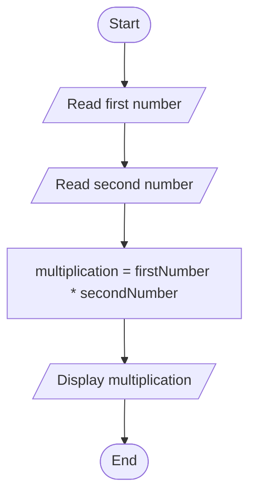
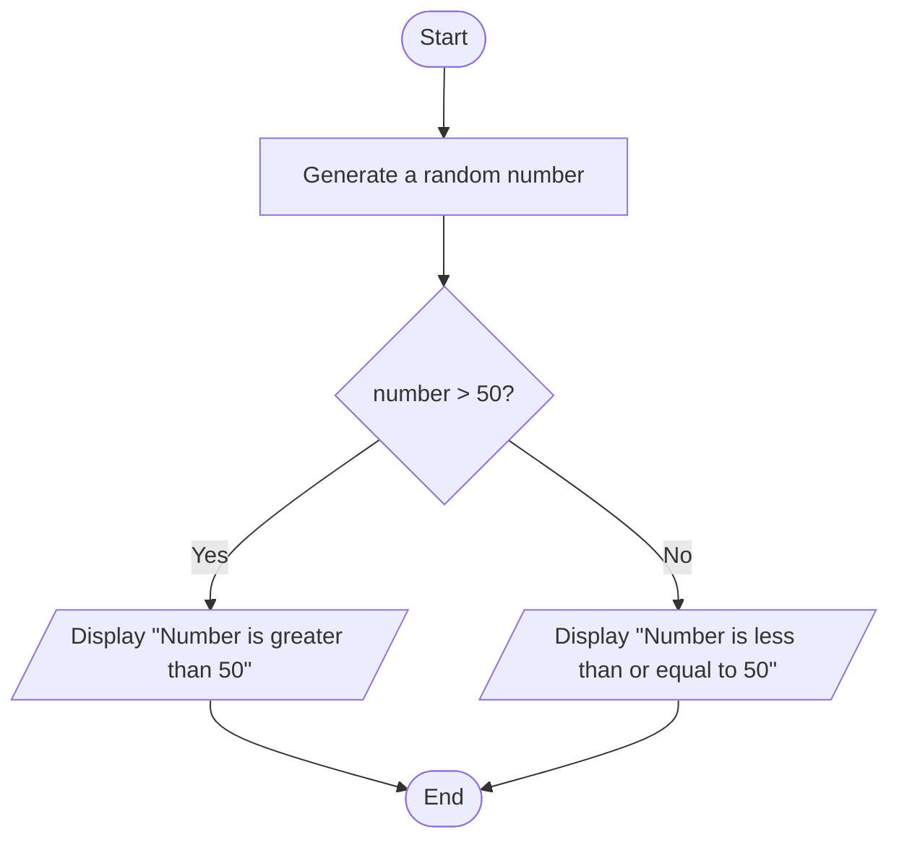
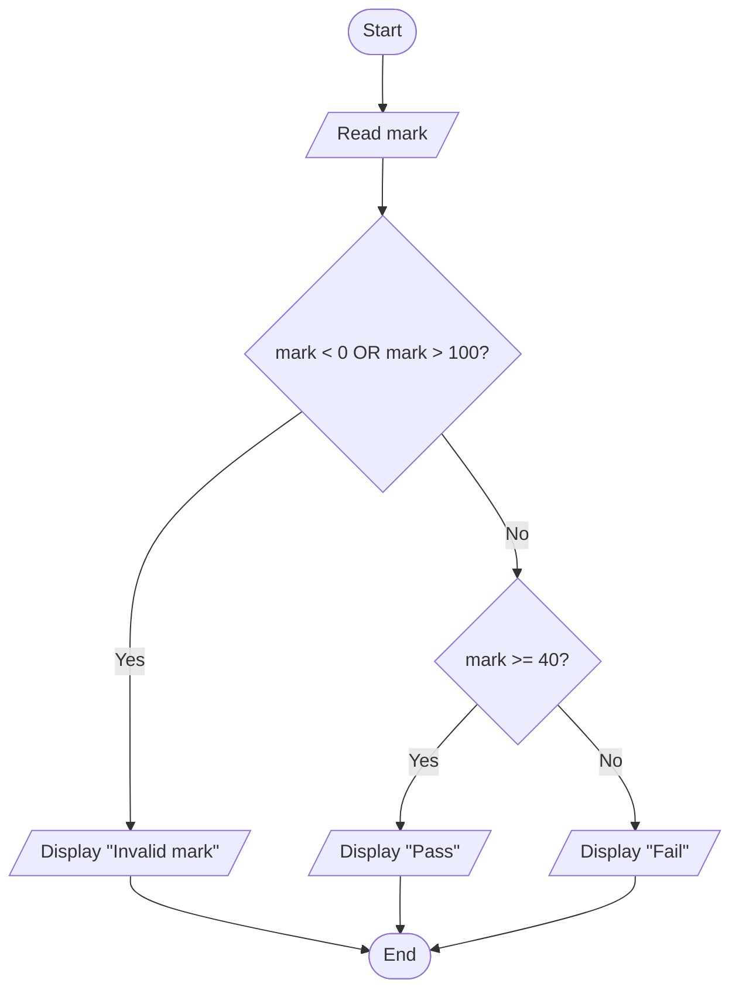
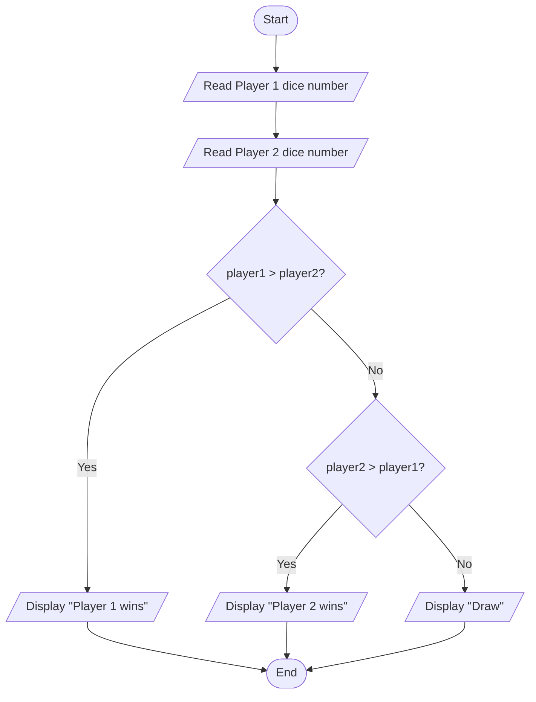
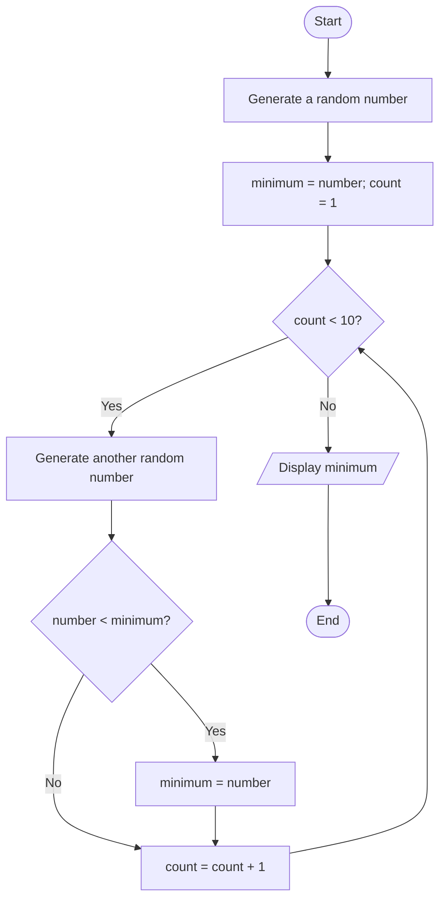
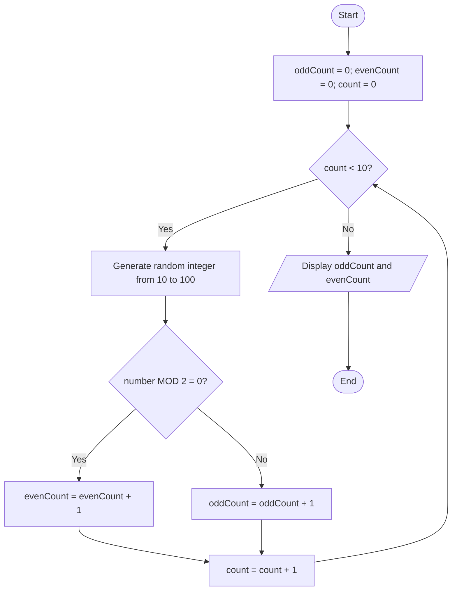
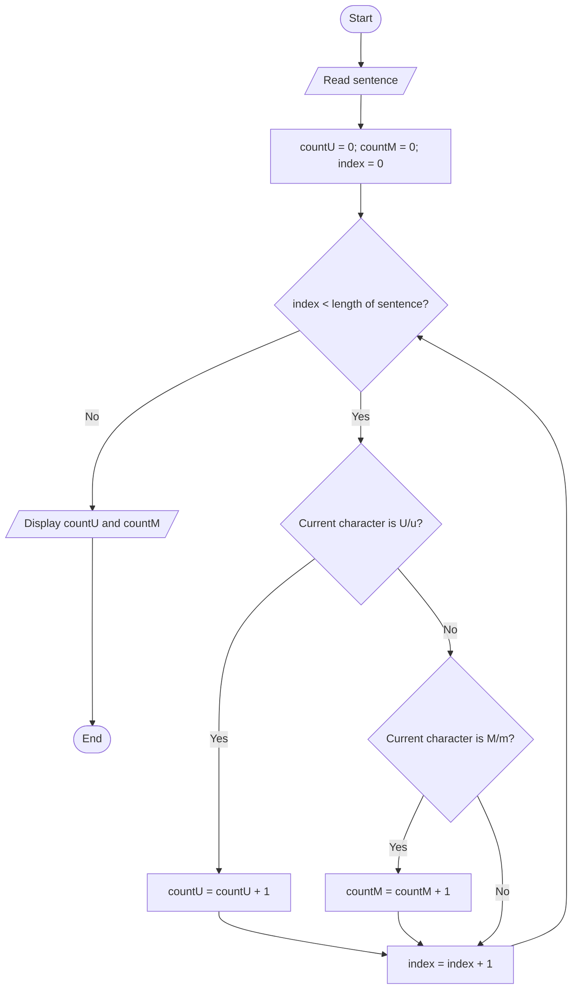
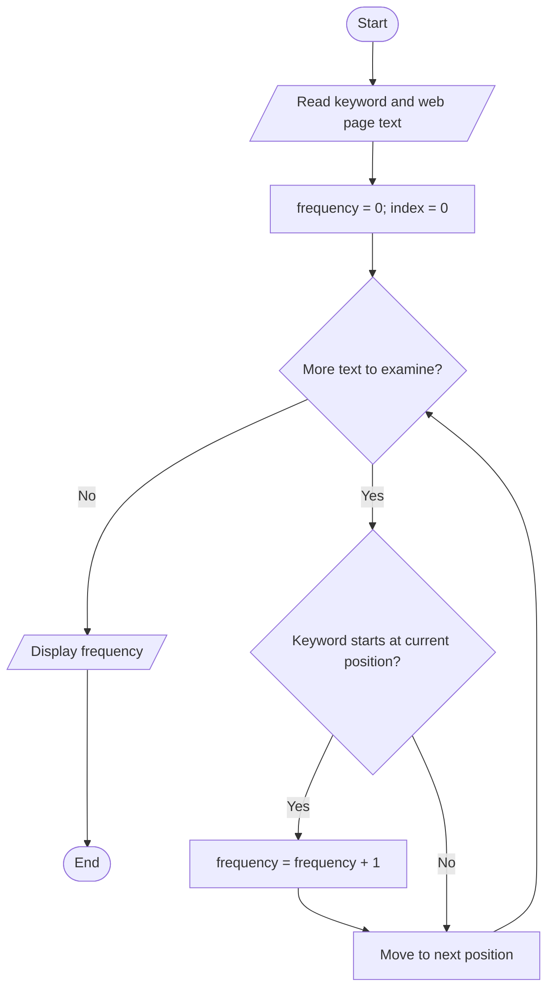
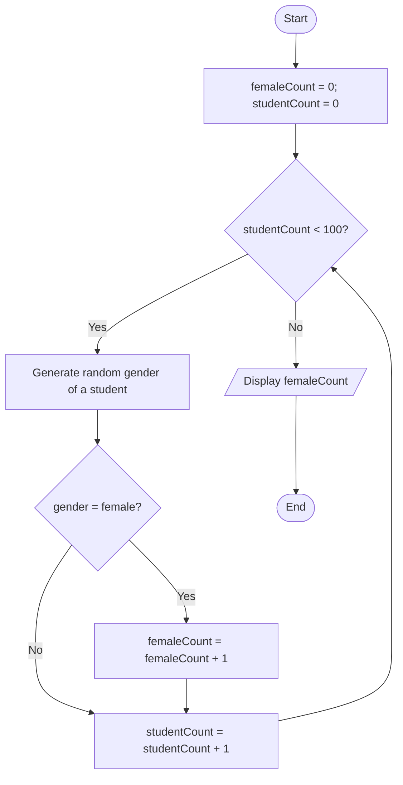
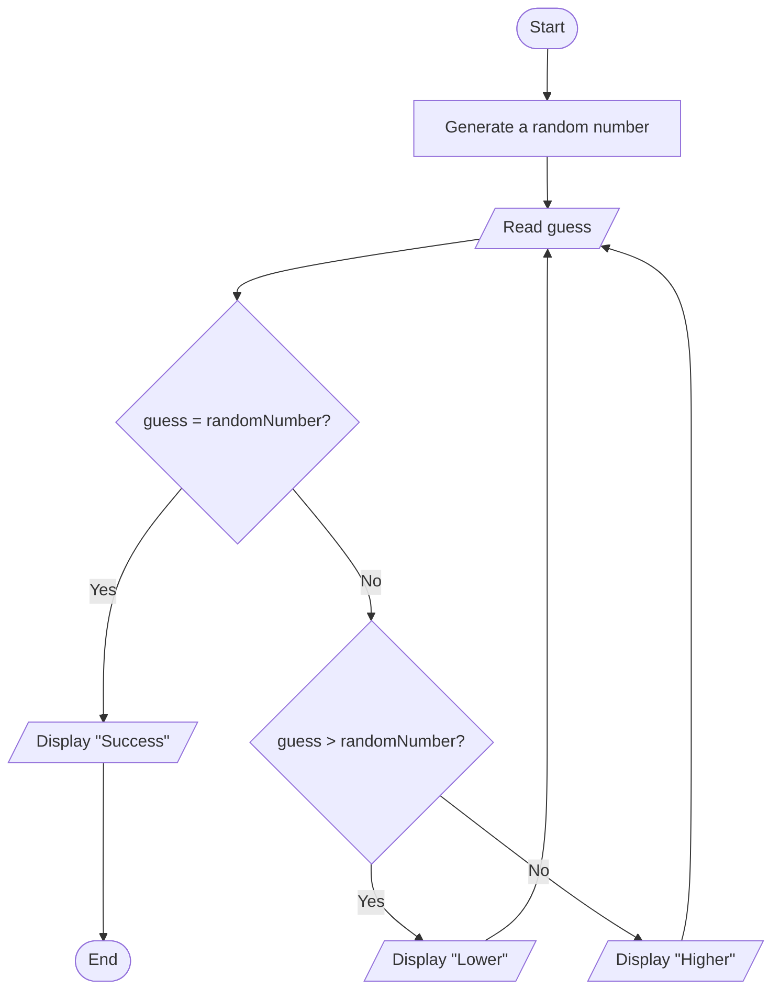

# Tutorial 01 - Answer
# Part I

## Question 1: Multiply two numbers

### IPO

| Input | Process | Output |
|---|---|---|
| First number, second number | Multiply the first number by the second number | Multiplication of the two numbers |

### Pseudocode

```text
START
    READ firstNumber
    READ secondNumber
    multiplication = firstNumber * secondNumber
    DISPLAY multiplication
END
```

### Flowchart



---

## Question 2: Determine whether a random number is greater than 50

### IPO

| Input | Process | Output |
|---|---|---|
| A random number generated by the computer | Generate a random number and compare it with 50 | Display whether the number is greater than 50 or less than or equal to 50 |

### Pseudocode

```text
START
    number = generate a random number
    IF number > 50 THEN
        DISPLAY "Number is greater than 50"
    ELSE
        DISPLAY "Number is less than or equal to 50"
    END IF
END
```

### Flowchart



---

## Question 3: Display pass or fail based on a mark (passing mark is 40)

### IPO

| Input | Process | Output |
|---|---|---|
| Mark | Validate 0-100, Compare the mark with passing mark | Display “Invalid mark”, “Pass” or “Fail” |

### Pseudocode

```text
START
    READ mark
    IF mark < 0 OR mark > 100 THEN
        DISPLAY "Invalid mark"
    ELSE IF mark >= 40 THEN
        DISPLAY "Pass"
    ELSE
        DISPLAY "Fail"
    END IF
END
```

### Flowchart



---

## Question 4: Display the result of a two-player dice game

### IPO

| Input | Process | Output |
|---|---|---|
| Random dice result for Player 1 and Player 2 | Compare result for Player 1 and Player 2 | Display the winner or a draw if the results are equal |

### Pseudocode

```text
START
    READ player1 random dice number
    READ player2 random dice number

    IF player1 > player2 THEN
        DISPLAY "Player 1 wins"
    ELSE IF player2 > player1 THEN
        DISPLAY "Player 2 wins"
    ELSE
        DISPLAY "Draw"
    END IF
END
```

### Flowchart



---

## Question 5: Print the perimeter of a rectangle

### IPO

| Input | Process | Output |
|---|---|---|
| Width and length | Calculate perimeter using `2 × (length + width)` | Perimeter of the rectangle |

### Pseudocode

```text
START
    READ width
    READ length
    perimeter = 2 * (length + width)
    DISPLAY perimeter
END
```

### Flowchart

```mermaid
flowchart TD
    A([Start]) --> B[/Read width and length/]
    B --> C[perimeter = 2 * (length + width)]
    C --> D[/Display perimeter/]
    D --> E([End])
```

---

## Question 6: Find the minimum of 10 random numbers

### IPO

| Input | Process | Output |
|---|---|---|
| 10 random numbers generated by the computer | Set the first number as the current minimum, then compare each remaining number and update the minimum when a smaller number is found | Minimum of the 10 random numbers |

### Pseudocode

```text
START
    number = generate a random number
    minimum = number
    count = 1

    WHILE count < 10
        number = generate a random number
        IF number < minimum THEN
            minimum = number
        END IF
        count = count + 1
    END WHILE

    DISPLAY minimum
END
```

### Flowchart



---

## Question 7: Count odd and even random numbers from 10 to 100

### IPO

| Input | Process | Output |
|---|---|---|
| 10 random numbers in the range 10–100 | Initialize odd and even counters to zero. Generate 10 numbers; if a number is divisible by 2, increment the even counter, otherwise increment the odd counter | Number of odd numbers and number of even numbers |

### Pseudocode

```text
START
    oddCount = 0
    evenCount = 0
    count = 0

    WHILE count < 10
        number = generate a random integer from 10 to 100

        IF number MOD 2 = 0 THEN
            evenCount = evenCount + 1
        ELSE
            oddCount = oddCount + 1
        END IF

        count = count + 1
    END WHILE

    DISPLAY "Odd numbers: ", oddCount
    DISPLAY "Even numbers: ", evenCount
END
```

### Flowchart



---

# Part II

## Question 8: Count the letters U and M in a sentence

### IPO

| Input | Process | Output |
|---|---|---|
| A sentence entered by the user | Read each character. Count occurrences of `U` and `M` | Number of U letters and number of M letters |

### Pseudocode

```text
START
    READ sentence
    countU = 0
    countM = 0
    index = 0

    WHILE index < length(sentence)
        IF sentence[index] = 'U' OR sentence[index] = 'u' THEN
            countU = countU + 1
        ELSE IF sentence[index] = 'M' OR sentence[index] = 'm' THEN
            countM = countM + 1
        END IF
        index = index + 1
    END WHILE

    DISPLAY "Number of U: ", countU
    DISPLAY "Number of M: ", countM
END
```

### Flowchart



---

## Question 9: Display the frequency of a keyword on a web page

### IPO

| Input | Process | Output |
|---|---|---|
| A keyword and the content of a web page | Read the web page text and count occurrences of the keyword | Frequency of the keyword |

### Pseudocode

```text
START
    READ keyword
    READ webPageText
    frequency = 0

    FOR each occurrence of keyword in webPageText
        frequency = frequency + 1
    END FOR

    DISPLAY frequency
END
```

### Flowchart



---

## Question 10: Count the number of female students in a random list of 100 students

### IPO

| Input | Process | Output |
|---|---|---|
| Gender of 100 randomly generated students | Initialize a counter to zero. Examine each student's gender and increment the counter if the student is female | Number of female students |

### Pseudocode

```text
START
    femaleCount = 0
    studentCount = 0

    WHILE studentCount < 100
        gender = randomly generate a student with gender

        IF gender = "female" THEN
            femaleCount = femaleCount + 1
        END IF

        studentCount = studentCount + 1
    END WHILE

    DISPLAY femaleCount
END
```

### Flowchart



---

## Question 11: Display five random numbers in descending order (sort)

### IPO

| Input | Process | Output |
|---|---|---|
| Five generated random numbers | Store the numbers in a list and sort them in descending order | List of five numbers from largest to smallest |

### Pseudocode

```text
START
    GENERATE five random numbers
    index = 0

    WHILE index < length(numbers)
        compare and sort the numbers into descending order
        index = index + 1
    END WHILE

    DISPLAY numbers
END
```

### Flowchart

```mermaid
flowchart TD
    A([Start]) --> B[Generate five random numbers]
    B --> C[index = 0]
    C --> D{index < length(numbers)}
    D -- Yes --> E[Compare and sort numbers in descending order]
    E --> F[index = index + 1]
    D -- No --> G[/Display sorted numbers/]
    F --> D
    G --> H([End])
```

---

## Question 12: Guess a random number generated by the computer

### IPO

| Input | Process | Output |
|---|---|---|
| User's guess(repeated until correct) | Generate a random number. Compare the guess with the random number; if equal, the guess is correct; if not, indicate whether the target is higher or lower and ask again | “Success”, “Higher”, or “Lower” |

### Pseudocode

```text
START
    randomNumber = generate a random number

    REPEAT
        READ guess

        IF guess = randomNumber THEN
            DISPLAY "Success"
        ELSE IF guess > randomNumber THEN
            DISPLAY "Lower"
        ELSE
            DISPLAY "Higher"
        END IF
    UNTIL guess = randomNumber
END
```

### Flowchart


